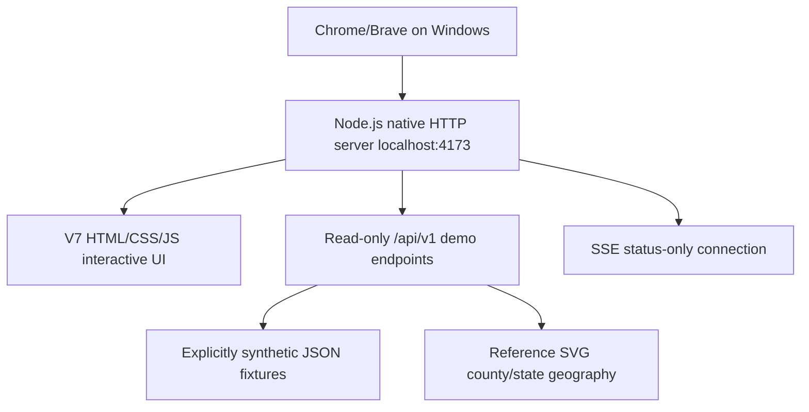
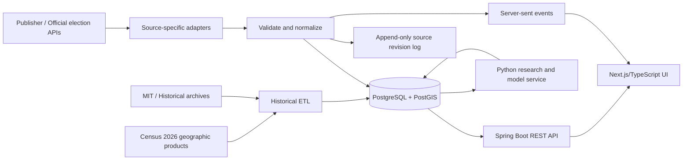

# Architecture: Phase 0 to Production

## Phase 1 implementation in progress

The preserved Phase 0 server remains the default launch path. The separate Phase 1 preview consists of a Next.js UI on `127.0.0.1:3000` and a Spring Boot API on `127.0.0.1:8080`; the Next.js rewrite proxies `/api/v1/` to Spring. The URL carries the global mode, year, office, state, district, provider and poll view. UI requests are canceled on context changes and responses are associated with the requested context to avoid displaying stale records.

The explicitly selected `demo` Spring profile reads fictional race fixtures from `data/demo` and never connects to PostgreSQL. The `local` profile uses PostgreSQL and Flyway, reads the source registry from that database, and does not expose demo race endpoints. Neither profile connects an election provider or a validated model. Both can serve the separately attributed prototype reference geography; it is not verified for 2026 districts. The client checks health mode before requesting race data and rejects a response whose test-data flag conflicts with that mode.

Flyway migrations `V1__registry.sql` and `V2__source_observations.sql` have been applied to a disposable PostgreSQL 17 instance. The source-observation schema rejects rows marked as test data, and fixture loading is isolated to the demo profile; the constraint alone cannot recognize mislabeled data. The local API reports non-connected or non-imported states; it is not an ingestion system. See `docs/POSTGRES_SETUP.md` and `docs/PHASE_1_REPORT.md` for run commands, verification and outstanding parity work.

## Current functional Phase 0

- Run without Docker or database; only Node 20+.
- Static V7 browser arrays are intentionally independent from API fixture arrays in Phase 0. Future phases remove that duplication and make the UI consume typed backend payloads.
- Server bound to `127.0.0.1`; do not open a public tunnel or treat its demo API as production.
- APIs expose no real vote counts, polls or probabilities. `/api/v1/models/races/:id` intentionally abstains.

## Target application architecture

### Component boundaries

**Spring Boot (Java 21)**: source adapters, canonical race IDs, state/office/district registry, vote normalization, idempotent source revisions, persistence, result aggregation, source attribution, API access, SSE broadcasting, operational health. Prefer a modular monolith; do not introduce Kafka, Redis or multiple Spring services without measured bottlenecks.

**PostgreSQL native on Windows**: migrations (Flyway), results and audit snapshots, source registry and legal rights, race status, candidate totals, polling documents, geometry versions, model-run history. Add PostGIS only when geospatial queries genuinely require it.

**Next.js/React/TypeScript**: reusable shell and 4-mode global context; national overview; Senate/Governor/House national views; all-election state dashboard; county explorer; House district selection; individual race result/model panels; polling and exit survey exploration; methodology and source health. State maps in SVG/MapLibre based on properly versioned official boundaries.

**Python 3.12+ (later phase)**: historical ETL, validation, backtesting, county trend analysis, expected turnout, uncounted-vote estimate, calibrated probabilistic modeling. Strict isolation between production model outputs and demo scenarios.

### Data paths

`Publisher response → raw immutable payload + metadata → provider mapping → validated canonical observation → append-only revision → materialized current race result → API + SSE`.

`2022/2024 historical vote files → schema validation + FIPS mapping + office validation + boundary-version check → historical store → comparison computation`.

`Race snapshot + historical baseline + reporting completeness + ballot type (if available) → model versioned run → estimates + uncertainty + abstention reason → individual race model panel`.

### State and routing

URL drives selection: `/elections/2026?mode=live&office=senate&state=TX`, `/elections/2026/states/TX?mode=history&year=2022&office=governor`, `/elections/2026/states/TX/house/07?mode=live`, `/polls?provider=...`, `/exit-polls?year=2026`. Decide exact Next.js routes in Phase 1 and write migration redirects if needed.

The four contexts must never leak between routes. A poll of a Senate race should never be displayed as a counted ballot or automatically reused for a House district.

### Reporting metric type invariants

- `estimated_vote_pct` ≠ `precincts_reporting_pct` ≠ `turnout_pct`.
- `poll_support_pct` ≠ `win_probability_pct` ≠ `vote_share_pct`.
- Reported leader ≠ published winner projection ≠ certified outcome.
- House districts need correct district polygons, may split counties; do not determine a House district from county colors.
- Never overwrite corrected source counts or call retractions; append a revision and recompute materializations.

### Deployment outline (later)

Local Windows: native PostgreSQL service + `mvnw spring-boot:run` + Python venv when needed + `npm run dev` Next.js. PowerShell `Start-All.ps1`, `Stop-All.ps1`, `Test-All.ps1`. Environment secrets in local `.env` excluded from git; no public API keys in the browser; startup health checks for each component.

Production design must address licensed providers, TLS, access control, distributed caching/CDN, source rate limits, audit immutability and spikes in election-night traffic. Phase 0 does none of these and should not be deployed publicly as real election results.
